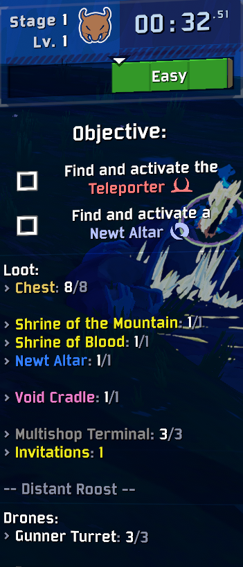

# StageTracker

Client-side Risk of Rain 2 mod that adds **Loot** and **Drones** panels to the HUD, tracking everything left on the current stage — shown all at once, with no teleporter-phase gating, using the game's own colors.



> The panels are inspired by HUDdleUP's loot/drone panels, rebuilt from scratch to cover all
> current content (Seekers of the Storm, Alloyed Collective, Hallowed Concepts) and to keep working
> across future updates.

## Features

### Loot panel
- Multishop terminals (paid, equipment variants, and the crashed/free "capsule" terminals tracked separately)
- Chests, split by kind: small, large, legendary, damage, healing, utility, adaptive, cloaked, timed security
- Scavenger backpacks
- Equipment barrels
- Rusty lockboxes and encrusted caches
- **Every shrine**: Chance, Mountain, Blood, Order, Combat (+ Collective variant), Woods, Halcyon, Shaping, Rebirth, Compulsion, Hallowed, Altar of Gold, Newt Altars, Cleansing Pools
- Scrapper, 3D printers (counts per item tier), Bazaar cauldrons
- Void chests (cradles & potentials), lunar pods, lunar seers
- Seekers of the Storm: Aurelionite geodes, Halcyon shrines, shrines of Shaping/Rebirth
- Alloyed Collective: Access nodes, temporary item distributors, Wandering CHEF
- Hallowed Concepts: Concept reliquaries, ghostly chests, gongs, anima portals
- Remaining enemy counts, pending Shrine of the Mountain invitations, stage name
- **Anything the mod doesn't recognize yet is still listed** (grouped by its in-game name), so content from future updates is never silently invisible

### Drone panel
- Gunner turrets
- Every purchasable drone by type, colored by its tier — including combiner-upgraded drones (a known gap in older mods)
- Triple drone shop (individual terminals)
- Drone scrapper & drone combiner station presence

### Display modes
- **Hold Tab** (default): panels appear while the scoreboard is held
- **Always visible**: panels stay docked on the right side of the screen, under the objective panel
- **Show Used Over Total**: display every counter as `used/total` (e.g. `Chest: 5/6`) even before you buy anything — with the option off, untouched counters show just the remaining amount (`Chest: 6`)

### Settings
Every tracked category can be toggled individually in the **in-game options menu under `Mods → Stage Tracker`** (via [Risk of Options](https://thunderstore.io/package/Rune580/Risk_Of_Options/)). All settings also live in the standard BepInEx config file (`BepInEx/config/kyle.stagetracker.cfg`).

## Notes
- **Client-side**: counts of spawned interactables are replicated, so panels work for every player. Two exceptions: chance-shrine purchase counts and mountain shrine invitations use host-only data and fall back to totals for clients.
- **Compatibility**: run this *instead of* HUDdleUP's loot/drone panels (HUDdleUP's other features don't conflict).

## Building
Requires the .NET SDK and a Risk of Rain 2 install. Reference paths are MSBuild properties:

```
dotnet build src/StageTracker.csproj -c Release \
  -p:GameDir="D:\SteamLibrary\steamapps\common\Risk of Rain 2" \
  -p:ProfilePluginsDir="C:\Users\you\AppData\Roaming\r2modmanPlus-local\RiskOfRain2\profiles\default\BepInEx\plugins"
```

The Release build assembles a Thunderstore-ready folder in `Release/` (manifest, icon, README at the zip root; DLL under `plugins/`). Zip the *contents* of `Release/` and upload.

### Debugging new content
The console command `stage_tracker_scan` dumps every interactable on the current stage (tokens, display names, cost types, components) to the log — use it to identify content the category table doesn't cover yet.
